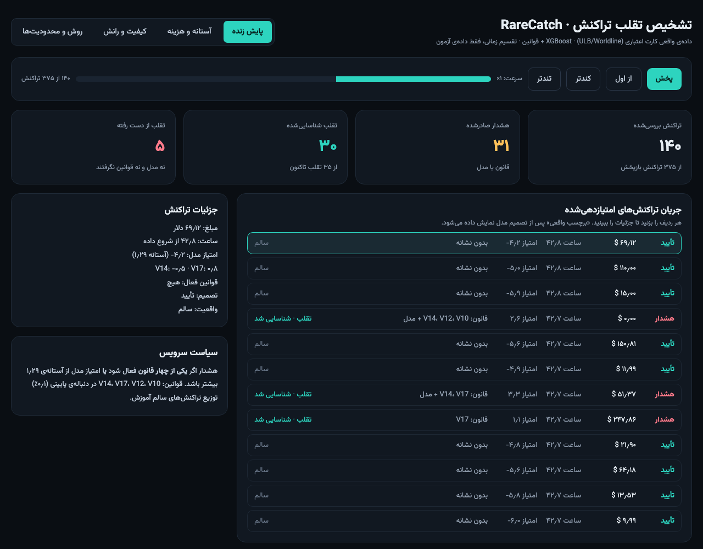
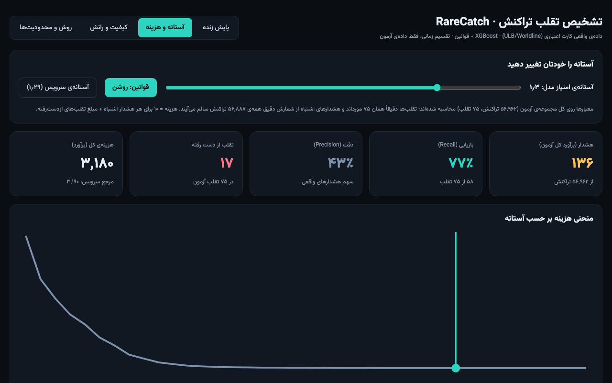
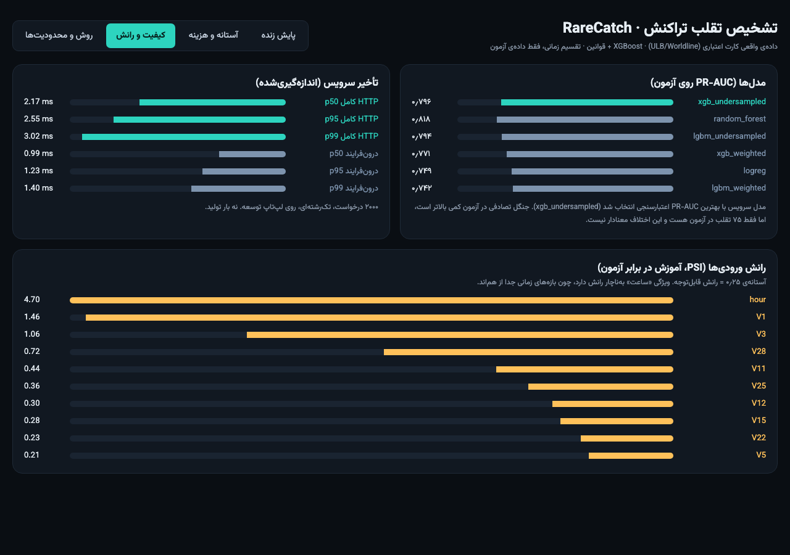

<div align="center">

# RareCatch

**Transaction fraud detection on extremely imbalanced data** · **تشخیص تقلب تراکنش روی داده‌ی بسیار نامتوازن**

Time-split evaluation · XGBoost / LightGBM · rules + ML hybrid · FastAPI at 2.5 ms p95 · playable Persian dashboard

[English](#english) · [فارسی](#فارسی)



</div>

## English

### What this is

A fraud-detection pipeline on the public ULB/Worldline credit-card dataset: 284,807 transactions, only 492 frauds (0.173%). Accuracy is meaningless at this ratio, so everything is judged by PR-AUC, precision/recall at a fixed alert budget, and an expected-cost threshold. The split is by time (no shuffling), as it would be in production.

### Highlights

- **Honest evaluation:** 60/20/20 time split, every threshold chosen on validation and frozen for test, no tuning on the test set.
- **Imbalance handling compared, not assumed:** class weights vs train-only undersampling, for both XGBoost and LightGBM, against logistic regression and Random Forest baselines.
- **Rules + ML:** four quantile rules on V14/V17/V12/V10 catch 57 of 75 test frauds alone; the served policy (rule OR model) catches 58 at a cost of 3,190.
- **Served and measured:** FastAPI `/score` with p50 2.17 ms / p95 2.55 ms end-to-end HTTP (single process, 2,000 sequential requests, dev laptop).
- **Playable dashboard** (Persian, RTL): replays real scored test transactions, shows each decision and reveals the true label, with a live threshold/cost simulator.

### Dashboard

Open `dashboard/index.html` in a browser (no build step; or `python3 -m http.server -d dashboard` and visit `localhost:8000`).

| Live replay | Threshold and cost | Quality and drift |
|---|---|---|
|  |  |  |

- The replay plays all 75 test frauds plus 300 randomly sampled legitimate transactions (fixed seed), so fraud is far more common than in reality. It is a replay of real held-out data, not live traffic.
- The threshold tab does not use that sample: fraud is the exact 75 cases and false alerts are exact counts over all 56,887 legitimate test transactions (`scripts/export_dashboard_data.py` writes `reports/dashboard_data.json`; the page embeds a snapshot).

## Details

Gradient-boosted fraud models on the public ULB/Worldline credit-card dataset (284,807 transactions, 492 frauds = 0.173%), evaluated with PR-AUC, fixed-alert-rate precision/recall and expected-cost thresholds, combined with a small rule layer, and served with FastAPI.
**Measured: 2.5 ms p95 end-to-end HTTP scoring latency (p50 2.2 ms), single process, 2,000 sequential requests, Apple-silicon laptop.**

### Run it

```bash
brew install libomp        # macOS only, needed by LightGBM/XGBoost
make setup data            # venv + pinned deps; downloads and converts the dataset
make eda train drift       # reports/ (results.md, results.json, pr_curves.png, eda.json, drift_psi.csv)
make bench                 # reports/latency.json
make serve                 # POST /score, GET /health on :8000
make test                  # needs `make train` first (the API test loads models/model.joblib)
curl -X POST localhost:8000/score -H 'content-type: application/json' \
  -d "$(.venv/bin/python -c \"import json;print(json.dumps({c:0.0 for c in ['Time']+[f'V{i}' for i in range(1,29)]+['Amount']}))\")"   # or open localhost:8000/docs
```

Python 3.14 was used (pins in `requirements.txt` are for that interpreter).

Data: the ULB dataset is fetched from its OpenML mirror (id 1597, same data as the Kaggle release, no login) by `scripts/download_data.py`. The 2013 data spans 48 h.

### Approach

- **Split:** sorted by `Time`, cut by position 60/20/20, no shuffling. Frauds: train 360, val 57, test 75.
- **Features:** 28 PCA components, `log1p(Amount)`, hour-of-day. Raw `Time` is deliberately excluded (with a time split, every test value is out of the training range).
- **Models:** logistic regression and Random Forest baselines (balanced class weights); XGBoost and LightGBM each with (a) `scale_pos_weight` = neg/pos and (b) random undersampling of train only to 20 negatives per fraud. Same features, splits and hyperparameters; early stopping on PR-AUC on the untouched validation set; no hyperparameter search.
- **Protocol:** every threshold (alert-rate quantile, cost-optimal) is chosen on validation and applied unchanged to test. The best GBM is chosen by validation PR-AUC.
- **Metrics:** PR-AUC = average precision. Precision/recall at fixed alert rates. Expected cost = 10 per false alert (assumed manual-review cost) + full `Amount` of every missed fraud.
- **Rules:** four conditions `V14/V17/V12/V10 <= c`, with `c` the 0.1th percentile of legitimate train transactions (train only). Hybrid = rule hit OR model score >= threshold.

### Results (test set, 56,962 transactions, 75 frauds)

| model | PR-AUC | P / R @0.1% alerts | P / R @0.5% | P / R @1% | cost-opt alerts | cost saved vs no model |
|---|---|---|---|---|---|---|
| logreg | 0.749 | 0.83 / 0.69 | 0.22 / 0.85 | 0.11 / 0.87 | 52 | 60.1% |
| random_forest | 0.818 | 0.82 / 0.79 | 0.26 / 0.87 | 0.11 / 0.87 | 64 | 65.0% |
| xgb_weighted | 0.771 | 0.85 / 0.75 | 0.22 / 0.84 | 0.12 / 0.85 | 62 | 48.9% |
| **xgb_undersampled** (selected on val) | 0.796 | 0.83 / 0.76 | 0.23 / 0.84 | 0.14 / 0.87 | 62 | 48.7% |
| lgbm_weighted | 0.742 | 0.85 / 0.69 | 0.22 / 0.83 | 0.11 / 0.83 | 84 | 45.4% |
| lgbm_undersampled | 0.794 | 0.81 / 0.75 | 0.23 / 0.84 | 0.14 / 0.87 | 69 | 51.2% |

Full table with validation scores and ROC-AUC: `reports/results.md`; curves: `reports/pr_curves.png`.

**Rules, ML and hybrid (selected model, test set; `@x%` rows are matched on alert rate):**

| strategy | alerts | TP | FP | recall | precision | cost |
|---|---|---|---|---|---|---|
| rules only | 134 | 57 | 77 | 0.76 | 0.43 | 3,209 |
| ML, cost-optimal | 62 | 54 | 8 | 0.72 | 0.87 | 3,963 |
| hybrid, cost-optimal (threshold fitted on non-rule rows) | 134 | 57 | 77 | 0.76 | 0.43 | 3,209 |
| rules OR ML cost-optimal (**served**) | 137 | 58 | 79 | 0.77 | 0.42 | 3,190 |
| ML @0.5% | 273 | 63 | 210 | 0.84 | 0.23 | 4,480 |
| hybrid @0.5% | 249 | 61 | 188 | 0.81 | 0.24 | 4,271 |
| ML @1% | 464 | 65 | 399 | 0.87 | 0.14 | 6,340 |
| hybrid @1% | 456 | 65 | 391 | 0.87 | 0.14 | 6,260 |

Findings:
- Differences between the tuned GBMs, Random Forest and logistic regression are within noise at 75 test frauds; the GBMs do not clearly beat the baselines here. Undersampling to 20:1 was equal to or slightly better than class weighting. With a 474x `scale_pos_weight` LightGBM's sigmoid saturates, so `predict_proba` ties at 1.0 for thousands of rows and PR-AUC collapses (val 0.08); ranking by raw margins fixes it (val 0.68, still below the ~0.78 of the other GBMs). This is why `scoring.py` ranks GBMs by margin and the API `score` is a margin.
- At matched alert rates the hybrid is no better than ML alone (0.5%: 61 vs 63 frauds caught, slightly lower cost; 1%: identical recall). The rules are strong on their own: V14/V17/V12/V10 lows catch 57/75 frauds with 134 alerts, and the cost-optimal hybrid collapses to "rules only" because on validation the 13 frauds the rules miss total only 4,474 in amount, which no threshold catches for less than 10 per false alert. The served rule: alert if any rule fires OR the ML score passes its own cost-optimal threshold (62 alerts alone). The lower hybrid cost (3,209 vs 3,963) is largely driven by a few fraud amounts, so treat it as suggestive, not conclusive.

### Serving and latency

`POST /score` takes the 30 raw fields (`Time`, `V1..V28`, `Amount`) and returns `{score, alert, rule_hits}`; `alert` = any rule hit OR score >= the ML cost-optimal threshold. `score` is the XGBoost margin (higher = riskier, not a calibrated probability). Model loaded once at startup, single-thread inference.

| measured over 2,000 sequential requests (test-set rows) | p50 | p95 | p99 |
|---|---|---|---|
| in-process (feature build + predict + rules) | 0.99 ms | 1.23 ms | see reports/latency.json |
| HTTP end-to-end (uvicorn, localhost, keep-alive) | 2.17 ms | 2.55 ms | see reports/latency.json |

Sequential single-client latency, not throughput under load.

### Drift

`make drift` writes PSI (train vs test) per feature and for the model score to `reports/drift_psi.csv`. The hour-of-day feature shows extreme PSI by construction: the test period covers a different part of the day cycle than train. This is a sign the two-day window cannot support seasonality claims, not an incident.

### Limitations

- Only 75 test (57 validation) frauds: PR-AUC and cost estimates are noisy; model rankings could flip with another split. No confidence intervals were computed.
- The 10-per-alert cost and "loss = full transaction amount" are assumptions, not Digipay figures.
- Features are PCA-anonymised, so rules are not interpretable business rules, and the rule cutoffs are specific to this dataset.
- Two days of data: no seasonality, no concept-drift evaluation; `hour` is weakly informative and drifts across the split.
- PaySim (optional second dataset) was not done. The dashboard is a replay of real test rows, not a live monitor.
- Fraud labels are used as ground truth with no delay; in production labels arrive late, which this setup ignores.

---

## فارسی

### این پروژه چیست؟

یک خط‌لوله‌ی تشخیص تقلب روی مجموعه‌داده‌ی عمومی کارت اعتباری ULB/Worldline: ۲۸۴٬۸۰۷ تراکنش که فقط ۴۹۲ مورد (۰٫۱۷۳٪) تقلب است. در چنین نسبتی «دقت کلی» بی‌معناست؛ بنابراین مدل‌ها با PR-AUC، دقت و بازیابی در یک بودجه‌ی ثابت هشدار، و آستانه‌ی مبتنی بر هزینه سنجیده شده‌اند. داده بر اساس زمان تقسیم شده (بدون بُر زدن)، درست مثل محیط واقعی.

### نکات برجسته

- **ارزیابی صادقانه:** تقسیم زمانی ۶۰/۲۰/۲۰؛ همه‌ی آستانه‌ها روی اعتبارسنجی انتخاب و بدون تغییر روی آزمون اعمال شده‌اند.
- **مقایسه‌ی روش‌های نامتوازنی:** وزن‌دهی کلاس در برابر کم‌نمونه‌گیری (فقط روی آموزش) برای XGBoost و LightGBM، در برابر رگرسیون لجستیک و جنگل تصادفی.
- **قوانین + یادگیری ماشین:** چهار قانون چندکی روی V14، V17، V12 و V10 به‌تنهایی ۵۷ از ۷۵ تقلب آزمون را می‌گیرند. سیاست سرویس (قانون یا مدل) ۵۸ مورد را با هزینه‌ی ۳٬۱۹۰ می‌گیرد.
- **سرویس‌دهی و اندازه‌گیری:** API با FastAPI؛ تأخیر HTTP سرتاسری p50 برابر ۲٫۱۷ و p95 برابر ۲٫۵۵ میلی‌ثانیه (یک پردازه، ۲۰۰۰ درخواست متوالی، لپ‌تاپ توسعه).
- **داشبورد فارسی و تعاملی:** تراکنش‌های واقعی آزمون را بازپخش می‌کند، تصمیم هر تراکنش را نشان می‌دهد و بعد برچسب واقعی را فاش می‌کند؛ به‌علاوه شبیه‌ساز آستانه و هزینه.

### داشبورد

فایل `dashboard/index.html` را در مرورگر باز کنید (بدون نیاز به build). تب‌ها: پایش زنده، آستانه و هزینه، کیفیت و رانش، روش و محدودیت‌ها.

- بازپخش شامل هر ۷۵ تقلب آزمون و ۳۰۰ تراکنش سالمِ نمونه‌ی تصادفی است؛ پس تقلب بسیار پرتکرارتر از واقعیت دیده می‌شود. این بازپخش داده‌ی واقعیِ کنارگذاشته‌شده است، نه ترافیک زنده.
- تب آستانه از این نمونه استفاده نمی‌کند: تقلب‌ها همان ۷۵ مورد دقیق‌اند و هشدارهای اشتباه از شمارش دقیق همه‌ی ۵۶٬۸۸۷ تراکنش سالم آزمون به دست می‌آیند.

### اجرا

دستورها در بخش Run it (بالا) آمده‌اند: `make setup data`، سپس `make eda train drift bench`، و برای سرویس `make serve`.

### محدودیت‌ها

- فقط ۷۵ تقلب در آزمون (۵۷ در اعتبارسنجی)؛ رتبه‌بندی مدل‌ها نویزی است و فاصله‌ی اطمینان محاسبه نشده.
- هزینه‌ی ۱۰ برای هر هشدار اشتباه فرض است، نه عدد واقعی Digipay.
- ویژگی‌ها ناشناس (PCA) هستند؛ قوانین معنای کسب‌وکاری ندارند.
- فقط دو روز داده: بدون فصلی‌بودن و ارزیابی رانش مفهومی.
